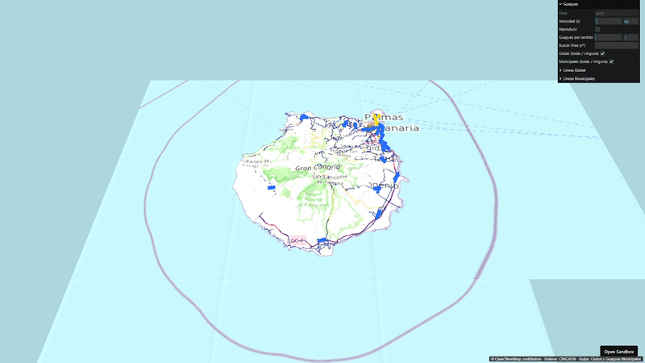
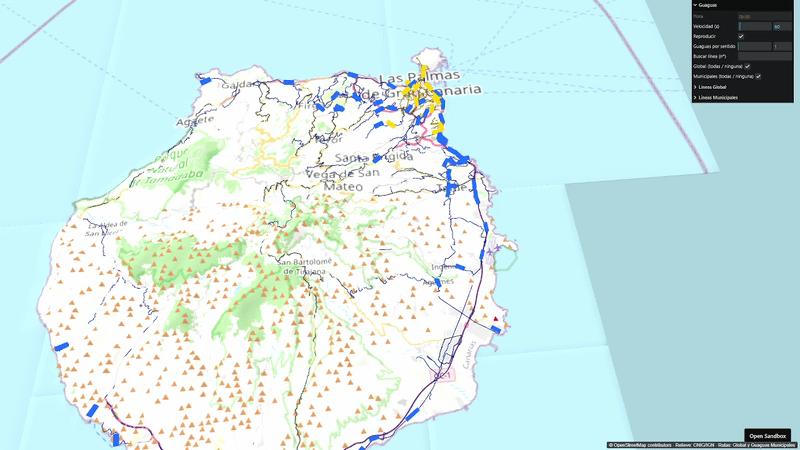

# Práctica guaguas de Gran Canaria

Visualización 3D interactiva de la red de guaguas de Gran Canaria hecha con [three.js](https://threejs.org/) (r152). Representa **152 rutas** de **Global** y **Guaguas Municipales** sobre un terreno con el relieve real de la isla, cubierto con el mapa de OpenStreetMap, que se vuelve más detallado a medida que te acercas. Sobre cada ruta circulan guaguas animadas que salen de sus cabeceras dentro del horario de la línea. Se puede buscar una línea por su número, elegir qué líneas se ven y pulsar una ruta para consultar sus paradas.

### Autor:
- [Arael Jesus Almeida Gonzlez](https://github.com/xAraelx)

**Proyecto en CodeSandbox:** [ENLACE AL SANDBOX](https://codesandbox.io/p/sandbox/guaguas-cmz5px)

**Vídeo de la ejecución:** [ENLACE AL VÍDEO](https://youtu.be/7X_i7mcNxoA)

**Vídeo de la ejecución reducido:** [ENLACE AL VÍDEO](https://drive.google.com/file/d/1zeBiwCuJjI3jMuo4HrzIYwY97xrmFVoY/view?usp=sharing)


------

## Previsualización del sistema


Vista general de la isla con todas las rutas



Simulación de las guaguas y Ruta seleccionada con sus paradas




------

## Estructura de la carpeta

```
/
|- src/
|  |- index.html                 #Pagina: solo carga index.js
|  |- index.js                   #Arranque: carga el relieve y lanza el bucle de animación
|  |- config.js                  #Constantes, colores y estado compartido
|  |- proyeccion.js              #Conversión de latitud y longitud a coordenadas de la escena
|  |- altura.js                  #Lee el mapa de alturas y devuelve la altura de cualquier punto
|  |- escena.js                  #Renderizador, cámara, controles y luces
|  |- teselas.js                 #Terreno con teselas de OpenStreetMap por niveles de detalle
|  |- camino.js                  #Posición y dirección a lo largo de un trazado
|  |- rutas.js                   #Dibuja las rutas pegadas al relieve
|  |- gui.js                     #Panel de control: hora, velocidad, buscador y líneas
|  |- simulacion.js              #Guaguas: lanzamiento, movimiento y reloj simulado
|  |- seleccion.js               #Clic en una ruta: resaltado, paradas y cuadro de información
|  |- guaguas.json               #Rutas, trazados, paradas y horarios (datos ya procesados)
|  |- gran_canaria_altura.png    #Mapa de alturas en grises
|- package.json
|- README.md
```

## Recursos necesarios

El proyecto está pensado para CodeSandbox, que instala las dependencias de `package.json`:

- `three` 0.152.1
- `lil-gui`
- `parcel-bundler` 1.x (como dependencia de desarrollo)

Hace falta **conexión a internet**, porque las teselas del mapa se descargan de los servidores de OpenStreetMap mientras se navega.

------

## Controles

| Zona | Control | Acción |
|---|---|---|
| **Mapa** | Arrastrar | Girar alrededor del punto de interés |
| | Rueda | Acercar / alejar (hacia el cursor) |
| | Clic derecho + arrastrar | Desplazar la cámara |
| | Clic en una ruta | Seleccionarla |
| | `Esc` o clic en el vacío | Quitar la selección |
| **Panel de la ruta** | Pestañas Ida / Vuelta | Ver las paradas de cada sentido |
| | Ver horarios | Abre la web del operador con los horarios de la línea |
| | ✕ | Cerrar el panel |

El panel de la esquina superior derecha (lil-gui) contiene:

| Control | Función |
|---|---|
| **Hora** | Hora simulada (si pasa de medianoche, indica `+1 día`) |
| **Velocidad (x)** | De ×1 a ×1200. A ×60, un segundo real equivale a un minuto simulado |
| **Reproducir** | Pausa o reanuda la simulación |
| **Guaguas por sentido** | De 1 a 3. Empieza en 1 |
| **Buscar línea (nº)** | Escribe uno o varios números separados por comas (`1, 5, 12`) para ver solo esas líneas, de los dos operadores |
| **Global / Municipales (todas / ninguna)** | Muestra u oculta todas las líneas de un operador |
| **Líneas Global / Líneas Municipales** | Casilla por línea, agrupadas en tramos de 50 (1–50, 51–100…) |

Mientras haya texto en el buscador manda la búsqueda; al borrarlo, vuelven a mandar las casillas.

------

## Descripción del trabajo

### Origen y preparación de los datos

- **Rutas y trazados**: relaciones de tipo `route=bus` de [OpenStreetMap](https://www.openstreetmap.org), descargadas con [Overpass Turbo](https://overpass-turbo.eu). Cada relación es un solo sentido, así que se **emparejaron** la ida y la vuelta de cada ruta por origen y destino invertidos (no por la letra I/V de OSM, que en las líneas municipales no es fiable).
- **Horarios**: de las webs de los operadores se tomaron la primera y la última salida de cada sentido y el enlace a los horarios de la línea.
- **Resultado**: `guaguas.json`, con **152 rutas** (109 de Global, en 98 líneas, y 43 de Guaguas Municipales, en 42 líneas), 304 trazados y unos 66.000 puntos en total (unos 2 MB). Los trazados se simplificaron para que el archivo pese poco.
- **Paradas**: cada sentido guarda sus paradas en orden, con nombre, posición y su fracción dentro del recorrido.
- **Duración del trayecto**: no la publican las empresas. Se **estima** dividiendo la longitud del trazado entre una velocidad media, que es de 35 km/h para Global y de 18 km/h para Guaguas Municipales (más urbanas, con paradas más frecuentes). Es un valor orientativo, no real.

### Terreno con relieve

- El relieve sale del **Modelo Digital del Terreno MDT25** del [CNIG](https://centrodedescargas.cnig.es) (celdas de 25 m). Se unieron 15 hojas, se pasaron a latitud y longitud y se convirtieron a un PNG en grises de 2048 × 2042 píxeles.
- El negro es 0 m (el mar) y el blanco son 1950 m, la altura del Pico de las Nieves. La altura en metros de cualquier punto se calcula como `gris / 255 × 1950`, con interpolación bilineal para suavizar los escalones de 8 bits (unos 7,6 m).
- Límites del mapa: oeste −15,84546, este −15,33995, sur 27,67844 y norte 28,18252.
- El relieve se exagera ×1,6 en vertical, y se compensa el estiramiento de la proyección de Mercator para que las proporciones sean coherentes.

### Mapa con teselas por niveles de detalle

Una sola imagen del mapa se pixelaría al acercarse, así que el mapa se carga como en una web de mapas, con **teselas** de OpenStreetMap:

- **Estructura**: se parte de las teselas de zoom 9 y cada una se sustituye por cuatro hijas de un nivel más al acercarse la cámara, hasta el zoom 16 (unos 2 m por píxel). Cuando la cámara se aleja, vuelve a mostrarse la tesela padre.
- **Sin huecos**: la tesela padre sigue visible hasta que se han descargado las cuatro hijas.
- **Solo lo necesario**: se piden únicamente las teselas que tocan la isla y que están en el campo de visión, con un máximo de 4 descargas simultáneas.
- **Relieve a cualquier zoom**: cada tesela es una malla de 24 × 24 segmentos levantada con el mapa de alturas. Lleva un faldón vertical en los bordes para tapar las grietas entre niveles de detalle distintos.

### Rutas

- Cada ruta es un único objeto de líneas (ida y vuelta juntas), con color por operador: azul oscuro para Global y ocre para Guaguas Municipales.
- Los trazados se subdividen en puntos cada unos 150 m y se elevan a la altura del terreno, para que sigan el relieve en vez de atravesar las montañas.

### Simulación de las guaguas

- Las guaguas son **rectángulos alargados** orientados en el sentido de la marcha: **azules** las de Global y **amarillas** las de Guaguas Municipales. Su tamaño crece al alejarse la cámara para que se sigan viendo desde lejos. Todas se dibujan en un solo `InstancedMesh`, con huecos reservados para un máximo de 6 por ruta.
- **Reglas de lanzamiento**:
  - Cada ruta tiene hasta 3 guaguas por sentido (6 en total).
  - Salen escalonadas dentro de un ciclo completo (ida, espera, vuelta, espera).
  - Al llegar a una cabecera, la guagua espera 2 minutos y sale en sentido contrario, así que cuando llega una de ida sale una de vuelta.
  - Solo se lanzan salidas entre la primera y la última salida de cada sentido, y las que ya están en ruta terminan su trayecto.
  - Si una línea acaba después de medianoche, la simulación sigue hasta el día siguiente.
- **Reloj**: empieza a las 06:00 y, al llegar a las 04:20 del día siguiente, vuelve a empezar.
- El movimiento se interpola sobre el trazado según la distancia acumulada, con la altura del terreno.

### Selección de rutas

Al pulsar una línea:

- La ruta se resalta en rojo y las demás se atenúan.
- Aparecen sus **paradas** sobre el mapa: en **cian** las de la ida y en **ámbar** las de la vuelta. Cambian al elegir la pestaña correspondiente.
- Se abre un **cuadro de información** con el número de línea, el operador, el origen y el destino, el botón para ver los horarios, y la lista de paradas de cada sentido como una línea de tiempo.
- Las rutas cuya vuelta es una variante distinta de la ida (10, 116 y 117 de Global y 64 de Guaguas Municipales) lo indican con un aviso.

------

## Fuentes

### Datos

- Mapa y trazados de las rutas: © [OpenStreetMap](https://www.openstreetmap.org/copyright) contributors, descargados con [Overpass Turbo](https://overpass-turbo.eu)
- Teselas del mapa: [servidor de teselas de OpenStreetMap](https://wiki.openstreetmap.org/wiki/Tile_usage_policy)
- Relieve: Modelo Digital del Terreno MDT25 del Instituto Geográfico Nacional de España, obtenido del [Centro de Descargas del CNIG](https://centrodedescargas.cnig.es)
- Rutas y horarios: web de [Guaguas Municipales](https://www.guaguas.com) y web de [Global](https://guaguasglobal.com)

### Documentación

- [Guía de la sesión 8](https://github.com/otsedom/otsedom.github.io/tree/main/IG/S8)
- [Documentación de three.js](https://threejs.org/docs/): `OrbitControls`, `InstancedMesh`, `BufferGeometry`, `LineSegments`, `Raycaster`
- [lil-gui](https://lil-gui.georgealways.com/)

### Asistencia de IA

- [Planteamiento del proyecto y de los datos necesarios (chat con Claude)](ENLACE)
- [Preparación de las rutas, los trazados y el mapa de alturas (chat con Claude)](ENLACE)
- [Código de la visualización con three.js (chat con Claude)](ENLACE)
